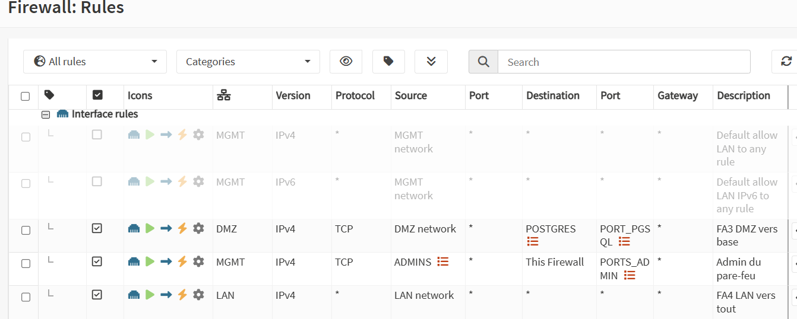
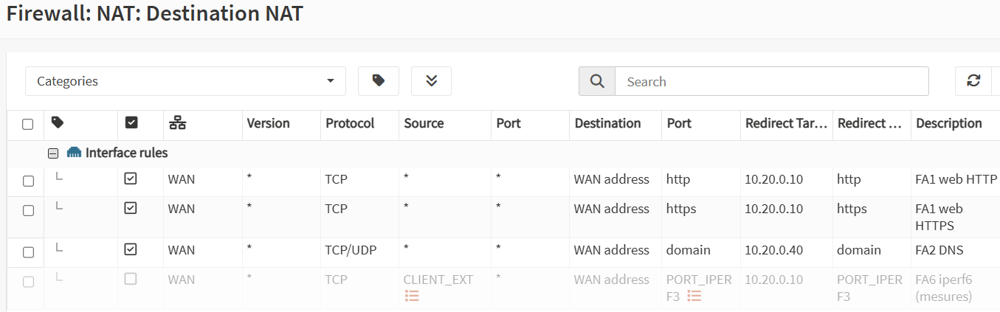
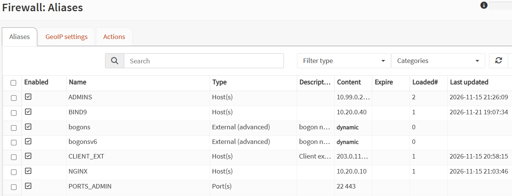
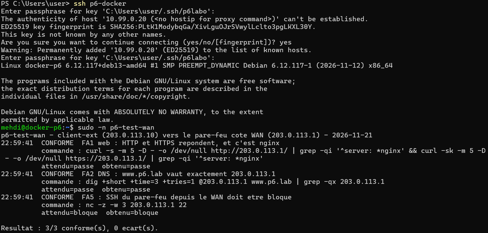
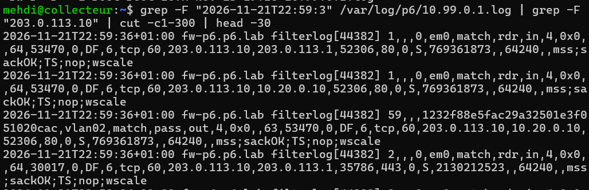
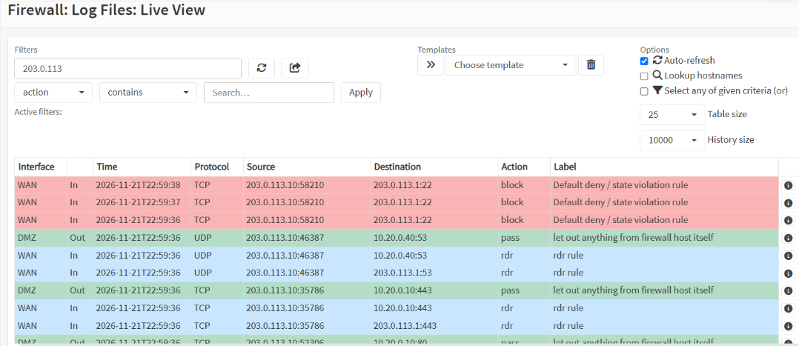

# Compte rendu 1 – Rôle 2 : Pare-feu OPNsense

## 1. Contexte et objectif

Dans le cadre du projet **« Architecture Zero Trust et défense réseau » (Projet 6 – GL3 INSAT)**, mon rôle consiste à participer à la sécurisation de l'infrastructure à travers l'administration et la vérification du pare-feu OPNsense 26.7 (fw-p6.p6.lab).

L'objectif de cette première phase était de vérifier l'état A (étapes 1 à 5 du guide du rôle 2) : inspecter la configuration existante du pare-feu et contrôler le comportement des règles de sécurité à travers trois tests ciblés : accès Web (FA1), service DNS (FA2) et blocage de l'accès SSH depuis le WAN (FA5). Cette phase a été réalisée principalement en lecture seule afin de préserver la configuration du laboratoire.

## 2. Inspection de la configuration existante

L'inspection a permis d'identifier quatre zones réseau : WAN, DMZ, LAN et MGMT (10.99.0.0/24).

Les principales règles d'interface actives relevées sont :

- **FA3 :** autorisation du trafic TCP de la DMZ vers PostgreSQL (10.10.0.70), sur le port 5432.
- **FA4 :** autorisation du trafic du LAN vers toutes les destinations.
- **Administration MGMT :** accès au pare-feu réservé aux administrateurs (ADMINS), sur les ports SSH 22 et HTTPS 443.

Aucune règle WAN explicite n'a été relevée dans les règles d'interface. Ce choix est voulu : voir la section 3. Le filtrage comprend également des règles automatiques, notamment le refus par défaut (*Default deny*) et la protection contre les violations d'état.

*Figure 1*

L'inspection du Destination NAT a révélé les redirections suivantes :

- **FA1 :** ports HTTP (80) et HTTPS (443) vers Nginx (10.20.0.10).
- **FA2 :** port DNS (53 TCP/UDP) vers BIND9 (10.20.0.40).
- **FA6 :** redirection iPerf3 (5201), désactivée et réservée aux mesures de débit (rôle 3).

*Figure 2*

Enfin, les alias permettent de regrouper les adresses IP et les ports utilisés dans les règles, notamment NGINX, BIND9, POSTGRES, ADMINS, PORTS_WEB et PORT_PGSQL. L'alias BIND9 valait 10.10.0.70 (la même valeur que POSTGRES), alors que la redirection FA2 vise 10.20.0.40. Aucune règle ne l'utilisait, donc sans effet sur le filtrage ; signalé à Karim, il a été corrigé en 10.20.0.40.

*Figure 3*

## 3. Résultats des tests de validation

Le 21/11/2026, entre 22:59 et 23:00, trois tests ont été réalisés depuis le conteneur externe client-ext (203.0.113.10), hébergé sur p6-docker, à l'aide du script p6-test-wan, avec l'accord préalable de Karim.

Les lignes de preuve sont extraites du journal du pare-feu conservé sur le collecteur (filterlog, figure 5), filtré sur 203.0.113.10 pour les secondes 22:59:36 à 22:59:38. La figure 4 montre la sortie du script, et la figure 6 la Live View correspondante.

*Figure 4*

| Flux | Interface, action | Source vers destination | Preuve |
|---|---|---|---|
| FA1 HTTP | em0 In, rdr | 203.0.113.10:52306 vers 203.0.113.1:80, puis vers **10.20.0.10:80** | le paquet est redirigé vers nginx, puis sortie (pass out) vers la DMZ |
| FA1 HTTPS | em0 In, rdr | 203.0.113.10:35786 vers 203.0.113.1:443, puis vers 10.20.0.10:443 | idem, en HTTPS |
| FA2 DNS | em0 In, rdr | UDP 46387 vers 203.0.113.1:53, puis vers **10.20.0.40:53** | redirigé vers bind9 |
| FA5 | em0 In, block | 203.0.113.10:58210 vers 203.0.113.1:22, à 22:59:36, 37 et 38 | bloqué, une seule tentative (SYN renvoyé 3 fois, même port source 58210) |

L'autorisation de FA1 et FA2 vient de la redirection NAT elle-même (option Firewall rule = Pass, écart E36) : il n'y a donc pas de règle **pass** explicite sur le WAN. Cela empêche un client externe de joindre les serveurs autrement que par le NAT.

Remarque : l'heure 22:59:41 affichée par le script p6-test-wan est celle du rapport ; les heures réelles des paquets sont celles du journal (22:59:36 à 22:59:38).

*Figure 5*

*Figure 6*

Les tests FA1 et FA2 ont confirmé le bon fonctionnement des redirections vers les serveurs Nginx et BIND9. La résolution DNS de www.p6.lab a notamment retourné l'adresse 203.0.113.1. La Live View a confirmé le transfert de la requête DNS vers 10.20.0.40:53, en conservant l'adresse IP réelle du client externe.

Pour FA5, la tentative de connexion SSH (un seul paquet SYN, renvoyé trois fois à une seconde d'intervalle depuis le même port source 58210) a été bloquée par OPNsense selon la règle Default deny / state violation rule, confirmant l'absence d'accès SSH autorisé depuis le WAN.

**Bilan : les trois tests sont conformes aux résultats attendus (3/3), sans écart de comportement du pare-feu (hors l'alias BIND9, corrigé et sans effet).**

## 4. Remarques et suite

Non vérifié à ce stade : le mode du Source NAT (la liste des règles est vide, le mode n'est pas affiché dans l'interface). Les étapes 6 (c2.py : flows.csv vers règles et tests.csv) et 7 (test_flux à 100 % et preuve S-05) feront l'objet du compte rendu suivant.
