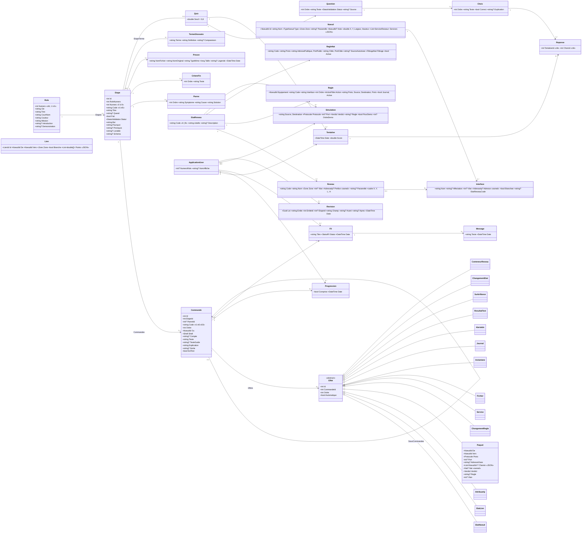

# Modèle de données — P6 Explorer

Écrit au jalon 2, **avant la première migration** (`app/P6Explorer.Infrastructure/Migrations/`). Base SQL Server LocalDB créée en Code First par EF Core 8 ; toute la configuration est en API Fluent (`app/P6Explorer.Infrastructure/Persistance/Configurations/`, une classe `IEntityTypeConfiguration<T>` par entité).

## 1. Diagramme de classes

## 2. Tables et choix de modélisation

| Table | Entité | Clé | Points notables (API Fluent) |
|---|---|---|---|
| `Roles6` | `Role` | `Numero` (non générée) | « Roles » est déjà utilisé par Identity (`AspNetRoles`) ; index unique sur `Cle` |
| `Etapes` | `Etape` | `Id` | index uniques `Code` et (`RoleNumero`, `Numero`) ; `Statut` stocké en texte |
| `Commandes` | `Commande` | `Id` | index unique `Code` ; `Ou` converti `NoeudId` ↔ texte ; auto-référence `ParentId` sans cascade (SQL Server refuse les cascades sur une auto-référence) |
| `Effets` | `Effet` et 14 types dérivés | `Id` | **héritage TPH** : une table, discriminateur `Type` (mêmes valeurs que le JSON polymorphe) ; colonnes partagées entre types frères (`Noeud`, `De`, `Vers`, `Nom`, `Port`, `Ip`, `CheminFichier`) ; `Chemin` en JSON ; `Nat` en **type owned** (colonnes `Nat_…`) |
| `Pannes`, `Criteres` | `Panne`, `CritereFin` | `Id` | 1-n avec `Etape`, cascade |
| `Preuves` | `Preuve` | `Id` | `NomFichier` unique (nom généré) ; auteur → `AspNetUsers`, mis à null si le compte est supprimé |
| `Glossaire`, `EtapeTerme` | `TermeGlossaire` | `Id` | **n-n** `Etape` ↔ `TermeGlossaire` par une table de jointure implicite |
| `Quiz` | `Quiz` | `Id` | **1-1** avec `Etape` : `HasOne().WithOne().HasForeignKey<Quiz>()`, `EtapeId` unique |
| `Questions`, `Choix` | | `Id` | 1-n en cascade depuis `Quiz` |
| `Tentatives` | `Tentative` | `Id` | utilisateur → cascade ; index (`UtilisateurId`, `QuizId`) |
| `Reponses` | `Reponse` | (`TentativeId`, `ChoixId`) | **n-n** Tentative ↔ Choix par une entité de jointure explicite ; pas de cascade depuis `Choix` (deux chemins de cascade depuis `Quiz` sinon) |
| `Progressions` | `Progression` | `Id` | index unique (`UtilisateurId`, `CommandeId`) |
| `Fils`, `Messages` | `Fil`, `Message` | `Id` | auteur en `Restrict` (un message reste si son auteur part) |
| `Simulations` | `Simulation` | `Id` | `EtatReseauCode` → `EtatsReseau` ; utilisateur mis à null à la suppression |
| `Revisions` | `Revision` | `Id` | **sans** clé étrangère vers l'étape : l'historique survit à une suppression ; index (`EtapeId`, `Date`) |
| `EtatsReseau` | `EtatReseau` | `Code` (« A », « B ») | réseaux, règles et règles NAT en cascade |
| `Noeuds` | `Noeud` | `Id` (`NoeudId` converti) | position dans le SVG (centre, taille) ; `Services` (ports en écoute lus par le moteur réseau) : **type owned rangé en JSON** dans une colonne (`ToJson`, jalon 3) |
| `Interfaces` | `Interface` | `Id` | `Adresse` en **type owned** (`AdresseIp` : adresse + préfixe) ; réseau en `Restrict` ; `Affectation` : nom de l'interface dans OPNsense (WAN, LAN, DMZ-WEB…), là où s'écrivent les règles (jalon 3) |
| `Reseaux` | `Reseau` | `Id` | `Code` unique ; `Prefixe` en **type owned** ; cadre de zone dans le SVG |
| `Liens` | `Lien` | `Id` (`LienId` converti) | `Points` de la polyligne en JSON |
| `Regles`, `ReglesNat` | `Regle`, `RegleNat` | `Id` | index (`EtatReseauCode`, `Equipement`, `Interface`, `Ordre`) : première correspondance ; `RegleNat.Filtrage` (`Aucune`, `Associee`, `Pass` : champ « Firewall rule » d'OPNsense, E36), en texte (jalon 3) |
| `AspNet…` | Identity | | `IdentityDbContext<ApplicationUser>` ; `NumeroRole` sur `AspNetUsers` |

**Propriétés shadow** `DateCreation` et `DateModification` : ajoutées dans `OnModelCreating` à toute entité racine qui implémente `IHorodate` (contenu éditable, questions, fils), absentes des classes C#, remplies par `IntercepteurHorodatage` (`SaveChangesInterceptor`).

**Lazy loading non activé** : les navigations sont chargées explicitement (`Include` / `ThenInclude`, ou `Entry().Collection().LoadAsync()` pour l'historique), pour éviter les requêtes N+1 (justification dans `docs/choix-techniques.md`).

## 3. Source des données

| Données | Origine | Moment |
|---|---|---|
| Rôles, étapes, commandes, effets, pannes, critères | `donnees/commandes/role-1.json` … `role-6.json`, produits par `P6Explorer.Importeur` depuis le guide | amorçage, une seule fois (base vide) |
| Topologie (nœuds, réseaux, liens, règles, NAT) | `donnees/topologie/etat-A.json` (toutes les machines) et `etat-B.json` (cartes, réseaux, règles et NAT de l'état B seulement : fusionnés dans les machines de A) | amorçage, une seule fois |
| Rôles Identity `Admin`, `Membre` ; compte admin | `RoleManager`, `UserManager` ; mot de passe dans les user-secrets | à chaque démarrage s'ils manquent |
| Révisions, quiz, tentatives, progression, fils, simulations, preuves | l'équipe, par l'application | en continu |

Après l'amorçage, **la base est la source de vérité** : les fichiers JSON ne sont plus relus.

## 4. Migrations

| Migration | Jalon | Contenu |
|---|---|---|
| `Initiale` | 2 | 34 tables |
| `MoteurReseau` | 3 | `Noeuds.Services` (JSON), `Interfaces.Affectation`, `ReglesNat.Filtrage` (défaut `Aucune`) |

L'amorçage de la topologie ne tourne que sur une base sans état réseau : une base créée avant le jalon 3 n'aurait pas l'état B. Aucune ne l'a été (LocalDB n'était pas installé) ; sinon, la supprimer (`dotnet ef database drop`) avant de relancer.
