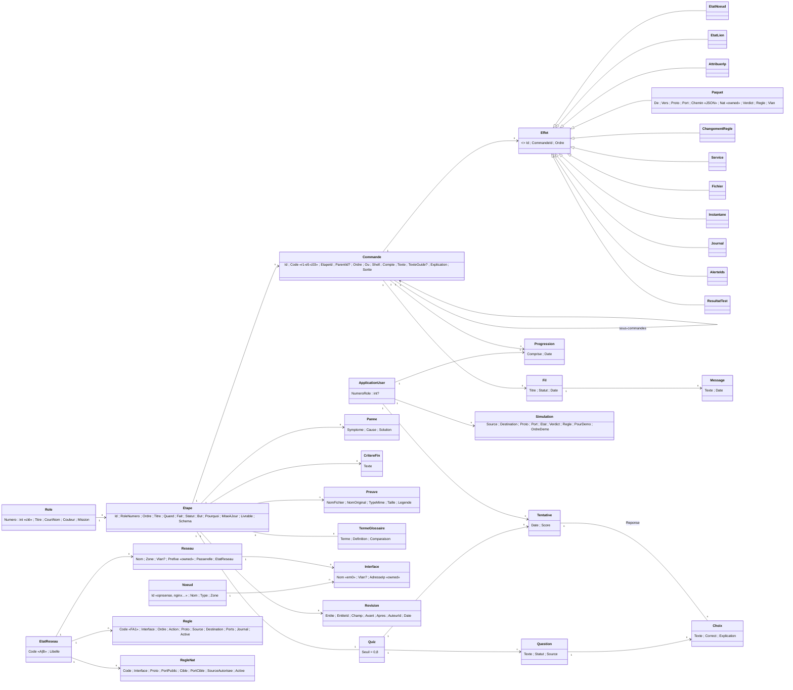

# Plan de la plateforme P6 Explorer

Jalon 1 (étude), 19 novembre 2026. Rédigé après lecture complète de `sources/etapes-par-role-P6.md` (4 275 lignes), des données du guide (`sources/guide/data/*.js`, `schemas-*.js`, `style.css`), de `ECARTS.md`, `docs/roles.md`, `docs/interfaces.md`, du `README.md`, et après l'étude du site de référence (`docs/style-reference.md`).

Ce document décrit **ce qui sera construit** ; aucune ligne de code n'est écrite à ce jalon. Les points à trancher sont dans `docs/questions.md`.

**Mise à jour du 20 novembre (réponses au jalon 1).** Plan validé avec ces décisions :

- Schéma **à plat** et **AutoMapper 13.0.1** : validés.
- Scripts du laboratoire disponibles dans `plateforme/labo/` (fusionnés depuis `main`) : `tests.sh` et `tests-cloisonnement.sh` donnent la liste exacte des 12 + 19 tests (section 5).
- **Texte des commandes** : pour les étapes marquées « fait », on affiche la commande **réellement utilisée** (compte `karim` + `sudo`, jamais `root@`) ; pour les autres, le texte du guide, avec l'écart signalé dans l'explication (section 8, décision 2).
- **Kali** : une seule route par défaut, via 203.0.113.1 (eth0) ; eth1 = 10.99.0.66 sur MGMT, sans passerelle.
- **Zone DNS** : `p6.lab` (`labo.test` est un reste de la conception).
- **Référence en cas de doute** : `ECARTS.md` (E31 à E42), puis les scripts de `plateforme/labo/`. Ce qui reste incertain est dans `docs/questions.md`, et on suit l'hypothèse la plus prudente.
- SDK .NET 8.0.428 installé le 20 novembre ; Visual Studio 2022 Community (avec LocalDB) installé par l'équipe.

---

## 1. Ce que disent les sources

### 1.1 Les 47 étapes

| Rôle | Étapes | Déjà faites (17 nov.) | Couleur |
|---|---|---|---|
| 1 Chef de projet · plateforme | 9 (1 à 9) | 1 à 5 | `--r1` |
| 2 Pare-feu et segmentation (C1, C2) | 9 (1 à 9) | 1 à 5 | `--r2` |
| 3 IDS/IPS et trafic légitime (C3, C4, C8) | 8 (**0** à 7) | — | `--r3` |
| 4 Services applicatifs et capture (C5, C10) | 8 (1 à 8) | 1 à 6 | `--r4` |
| 5 Validation et attaques (C6, C7) | 6 (1 à 6) | 1 en partie | `--r5` |
| 6 Observabilité et analyse (C9, C11, NTP) | 7 (1 à 7) | 1, 2 en partie | `--r6` |
| **Total** | **47** | | |

L'étape 0 du rôle 3 est rangée à part dans le guide (`G.roles.ids.prep`) : l'importeur doit la lire en plus de `steps`.

### 1.2 Structure réelle des données du guide

Le prompt annonce les champs `cmd, code, faire, sortie…`. Les fichiers `role-*.js` utilisent en fait :

| Champ | Contenu | Devient |
|---|---|---|
| `titre, quand, fait, maj, but, pourquoi` | textes de l'étape (HTML léger) | `Etape` |
| `prereq` | `{etapes:["chef-3"], modules:[8], texte}` | `Etape.Prerequis` |
| `ui[]` | `{path, faire}` : un chemin de menu et l'action | **commandes graphiques** (`OpnsenseGui`, `VmwareGui`, `WindowsGui`…) |
| `config[]` | `{t, code}` : bloc de commandes, ou `{t, file, code}` : contenu d'un fichier | commandes shell (une par ligne utile) ; un fichier = une commande « écrire le fichier » avec effet `Fichier` |
| `tester[]` | `{t, cmd, sortie, sens:[[motif, explication]]}` | commandes de test avec **sortie attendue** et explication de chaque partie de la sortie |
| `pannes[]` | `[symptôme, cause, solution]` | `Panne` (affichée dans l'explication, source des questions de quiz) |
| `fini[]`, `livrer` | critères de fin, livrables | `CritereFin`, `Etape.Livrable` |
| `schema`, `schemaSt` | nom d'un schéma du guide (`proxmox-topo`, `nat-steps`, `trunk-tag`, `netmap-position`…) | indique le **calque** ou l'agrandissement à montrer pour l'étape |
| `questions`, `demo` (par rôle) | 5 questions du jury, démonstration de 2 min | amorçage des quiz, page démo |

### 1.3 Nombre de commandes par rôle

Le sommaire de la source principale compte les **lignes** des blocs, contenu des fichiers compris (105 / 146 / 160 / 254 / 210 / 253 = 1 128 lignes). Ce qui sera rejoué, ce sont des **commandes** : une ligne shell utile (hors commentaires et sorties), une action dans une interface graphique, ou l'écriture d'un fichier. Comptage fait sur les données du guide :

| Rôle | Lignes shell | Commandes de test | Actions graphiques | Fichiers écrits | **Commandes avant dépliage** | Scripts à déplier (prompt, règle 4) |
|---|---|---|---|---|---|---|
| 1 | 81 | 11 | 18 | 2 | **112** | `tests.sh` (12), `tests-cloisonnement.sh` (19), `restreindre-ssh.sh`, `setup-*.sh`, boucles `vmrun` |
| 2 | 2 | 30 | 22 | 2 | **56** | `c2.py`, `test_flux.sh` (8 tests en A, 42 en B) |
| 3 | 44 | 10 | 9 | 8 | **71** | `tester.sh` (6 captures), `sonde.sh start/stop` |
| 4 | 43 | 21 | 0 | 11 | **75** | `reseaux-A.sh`, `reseaux-B.sh`, `capture.sh`, boucle d'inventaire |
| 5 | 32 | 10 | 0 | 2 | **44** | `orchestrateur.py` (6 scénarios + P-01) |
| 6 | 19 | 9 | 0 | 8 | **36** | `parse.py`, `correle.py` |
| **Total** | 221 | 91 | 49 | 33 | **≈ 394** | **≈ 480 à 520 après dépliage** |

Le comptage exact sera produit par l'importeur (jalon 2) et tenu à jour dans `docs/a-completer.md`.

### 1.4 Les scripts réels du laboratoire (`plateforme/labo/`)

Absents au 19 novembre, fusionnés le 20 depuis `main` (commit `3d7911b`). Ils sont la **référence de la plateforme réelle** pour les étapes déjà faites :

| Script | Ce qu'il apporte au projet |
|---|---|
| `docker/p6-etat-a/docker-compose.yml`, `setup.sh` | projet Compose `p6`, réseaux macvlan sur `ens33.20`, `ens33.10`, `ens34` ; images réelles `p6/outils:1`, `p6/api:1`, `nginx:1.27-alpine`, `postgres:17`, `internetsystemsconsortium/bind9:9.20` ; adresses des 10 conteneurs |
| `docker/p6-etat-a/tests.sh` | **les 12 tests** de l'état A (section 5) |
| `docker/p6-etat-a/{api,bind,db,nginx,outils}/` | contenu réel de l'API, de la zone `p6.lab`, du schéma SQL, de `pg_hba.conf`, de nginx |
| `kali/setup-kali.sh`, `kali/tests-cloisonnement.sh` | adresses de Kali (passerelle 203.0.113.1 sur eth0) ; **les 19 tests** de cloisonnement |
| `collecteur/setup-collecteur.sh` | chrony `allow 10.99.0.0/24`, `local stratum 8` ; rsyslog UDP 514 → `/var/log/p6/%FROMHOST-IP%.log` |
| `commun/restreindre-ssh.sh` | table `inet p6_ssh` (TCP 22 depuis 10.99.0.2 et 10.99.0.10) |
| `acces/*.ps1`, `panneau/*` | accès de l'équipe (OpenSSH Windows, clés), panneau de contrôle |

Ces fichiers seront lus (sans aucun secret) par l'importeur pour remplacer les commandes du guide des étapes « fait » par les commandes réellement exécutées.

### 1.5 Le poste de travail

Au 19 novembre : runtime .NET 8.0.21 seulement. Le 20 novembre : **SDK .NET 8.0.428 installé** (`winget`) ; Visual Studio 2022 Community avec la charge « Développement web et ASP.NET » (et donc LocalDB) installé par l'équipe. Node.js 26 et Git sont présents.

---

## 2. Les écrans

Toute l'interface est en français, en tutoiement. Chaque terme technique porte une infobulle du glossaire.

| Écran | Route (MVC) | Contrôleur · vues | Accès | Contenu |
|---|---|---|---|---|
| Accueil | `/` | `Home/Index` | public | Carte complète de l'état A, animée doucement en fond (paquets de la sonde, NTP, syslog) ; 6 cartes de rôle (couleur, mission, n étapes, % fait, % maîtrisé si connecté, questions ouvertes) ; bascule A ↔ B |
| Vue rôle | `/Roles/{n}` | `Roles/Details` · `_ListeEtapes` | public | Liste des étapes (titre, date, pastille fait / à faire, statut Brouillon / À valider / Validée, date de dernière modification, compteur de questions ouvertes) |
| Vue étape (lecteur) | `/Roles/{n}/Etapes/{e}?commande={c}` | `Etapes/Details` · `_Schema`, `_Terminal`, `_PanneauExplication`, `_DecodeurOctets`, `_ListeEtapes` | public | Schéma dynamique, terminal rejoué, explication + décodeur, contrôles, calques ; URL partageable par commande |
| Fiche de l'étape | onglet de la vue étape | `Etapes/Details` | public | But, pourquoi, prérequis, pannes connues, critères de fin, livrables, preuves (captures jointes) |
| Édition d'étape | `/Roles/{n}/Etapes/{e}/Modifier` | `Etapes/Edit` | `ModifierSonRole` | Formulaire de l'étape ; liste ordonnable des commandes |
| Édition de commande | `/Commandes/{id}/Modifier`, `/Etapes/{e}/Commandes/Ajouter` | `Etapes/EditCommande`, `CreateCommande`, `DeleteCommande` | `ModifierSonRole` | Texte, explication, sortie, ordre, machine, shell ; effets (ajout / suppression / ordre, formulaire par type d'effet) |
| Historique | `/Roles/{n}/Etapes/{e}/Historique?page=` | `Etapes/Historique` | membre connecté | Révisions paginées (qui, quand, champ, avant → après), bouton « Revenir à cette version » |
| Preuves | `/Etapes/{e}/Preuves/Ajouter` | `Etapes/AjouterPreuve` | `ModifierSonRole` | Envoi PNG / JPEG ≤ 5 Mo (`IFormFile`), légende |
| Quiz | `/Quiz/{etapeId}` | `Quiz/Passer`, `Quiz/Resultat` | `[Authorize]` | Questions à un ou plusieurs choix, score, seuil (80 %), correction expliquée |
| Questions et réponses | `/Discussions?commande=&page=`, `/Discussions/{id}` | `Discussions/*` | lecture publique, écriture connectée | Fils par commande, réponse du responsable, « résolu » |
| Et si ? | `/Simulation` | `Simulation/Index` | public ; enregistrement connecté | Source, destination, protocole, port, état A/B → chemin animé, verdict, règle ; historique paginé |
| Démo | `/Simulation/Demo` | `Simulation/Demo` | public ; ordre modifiable par connecté | Simulations marquées « pour la démo », rejouées dans l'ordre choisi |
| Glossaire | `/Glossaire` | `Glossaire/Index` | public | Terme, une phrase, une comparaison concrète, étapes liées |
| Admin › Comptes | `/Admin/Comptes` | `Admin/*` | `Admin` | Création des 5 membres avec leur numéro de rôle (`UserManager`) |
| Admin › Avancement | `/Admin/Avancement` | `Admin/Avancement` | `Admin` | Commandes comprises par membre et par rôle |
| Admin › Préparation de la soutenance | `/Admin/Soutenance` | `Admin/Soutenance` | `Admin` | Meilleur score et date par membre et par étape ; étapes que personne ne maîtrise |
| Connexion, compte | `/Identity/Account/*` | pages Identity générées puis traduites | public | Connexion, déconnexion, mot de passe |
| API | `/api/etapes/{id}/commandes`, `/api/simulation`, `/api/sante`, `/swagger` | `[ApiController]` + Minimal API | public (lecture) | DTO JSON pour l'animation ; état de santé ; documentation en développement |

### Le lecteur de commandes (cœur de l'application)

1. La page est rendue côté serveur : SVG de la topologie (état courant), liste des commandes, panneaux vides.
2. `lecteur.js` appelle `GET /api/etapes/{id}/commandes?etat=A` et reçoit, pour chaque commande, le texte, la machine, le shell, la sortie, l'explication et **les effets déjà calculés** (chemins, NAT, verdict, règle, octets décodés).
3. Pour chaque commande : surbrillance de la machine, frappe du texte dans le terminal (invite selon la machine et le compte : `karim@p6-docker:~$`, `PS C:\>`, `root@fw-p6:~ #`, `OPNsense › Firewall › NAT › Destination NAT`), puis effets dans l'ordre, puis sortie attendue.
4. Un paquet suit son chemin saut par saut ; sur OPNsense il marque une pause : traduction NAT affichée (`203.0.113.1:443 → 10.20.0.10:443`), puis la règle qui décide (« FA1 · pass » en vert, « FA5 · refus par défaut journalisé » en rouge).
5. Clic sur un paquet (schéma ou tableau) : le décodeur s'ouvre (couches, champs, hexa synchronisé au survol).

Contrôles : ▶ / ⏸ / ⏭ / ⏮, vitesse ×0,5 à ×4, curseur de chronologie, touches ← → espace. La vitesse et l'état A/B choisis sont gardés en **session**.

### Calques du schéma

Zones (WAN, DMZ, LAN, MGMT, trunk) · adresses IP · règles (étiquette de règle sur chaque interface d'OPNsense) · journaux vers le collecteur (paquets syslog et NTP) · alertes Suricata (sondes netmap sur em0 et em1, bulles d'alerte). Chaque calque est une case à cocher ; le choix est gardé dans le navigateur.

---

## 3. Le schéma de données

Diagramme provisoire ; la version définitive sera écrite dans `docs/modele-donnees.md` au jalon 2, **avant** la première migration.

Choix déjà arrêtés :

- **Effets en héritage TPH** (une table `Effets`, discriminateur `Type`), sérialisés en JSON polymorphe (`[JsonPolymorphic]` / `[JsonDerivedType]`) pour l'API et les fichiers d'amorçage. Les records du prompt deviennent des classes `record` avec une clé `Id` et un `CommandeId` ; les listes (`Chemin`) sont stockées en JSON par un convertisseur de valeur ; `Nat` est un type owned.
- **Types owned** : `AdresseIp` (adresse + longueur de préfixe) dans `Interface` et `Reseau`, `Nat` dans `Paquet`.
- **Relations** : 1-1 `Etape`↔`Quiz` (`HasOne().WithOne().HasForeignKey<Quiz>()`), n-n `Etape`↔`TermeGlossaire` (table de jointure implicite), n-n `Tentative`↔`Choix` par l'entité `Reponse`.
- **Propriétés shadow** `DateCreation` / `DateModification` sur les entités éditables, remplies par l'intercepteur ; le même intercepteur écrit les `Revision` (champ par champ, à partir du `ChangeTracker`).
- **Topologie en base** (Noeud, Interface, Reseau, Regle, RegleNat, par `EtatReseau`), amorcée depuis `donnees/topologie/etat-A.json` et `etat-B.json`. Le moteur, lui, ne connaît pas EF : il reçoit un objet `Topologie` construit par un repository.
- **Ce que la base ne stocke pas** : le décodage octet par octet (calculé à la demande par `DecodeurPaquet`, déterministe) et les chemins des paquets dont `Chemin` est vide (calculés par le moteur à la lecture, pour suivre l'état A/B choisi).

---

## 4. Le langage d'effets

Repris du prompt (section 5), avec trois compléments rendus nécessaires par les sources :

| Effet | Champs | Exemple tiré du guide |
|---|---|---|
| `EtatNoeud` | Noeud, Etat (creer, allumer, eteindre, suspendre, surbrillance) | `vmrun … revertToSnapshot` → VM suspendues |
| `EtatLien` | Lien, Branche | carte NAT débranchée (`startConnected = "FALSE"`) |
| `AttribuerIp` | Noeud, Carte, Ip | `address 10.99.0.10/24` sur `ens32` |
| `Paquet` | De, Vers, Proto, Port, Chemin?, Nat?, Verdict, Regle?, Vlan? | `nc -zv -w 2 203.0.113.1 22` → FA5, bloqué |
| `ChangementRegle` | Action (ajouter, modifier, désactiver, supprimer, vider-etats), IdRegle, Resume | Destination NAT FA1 ; `pfctl -F states` |
| `Service` | Noeud, Nom, Demarre, Port? | `systemctl enable --now chrony` |
| `Fichier` | Noeud, Chemin, Cree | `/etc/p6-ssh-filtre.nft` |
| `Instantane` | Vm, Nom | `etat-A` |
| `Journal` | De, Ligne | ligne `filterlog` vers 10.99.0.10 |
| `AlerteIds` | Signature, Blocage | sid 9000002 « blocked » |
| `ResultatTest` | Nom, Ok, Compteur | `12 / 12 conformes` |
| **`Surbrillance`** (ajout) | Noeud, Fichier?, Texte? | `cat`, `grep`, `tail` : règle 1 du prompt |
| **`ChangementEtat`** (ajout) | Etat A ou B | rôle 2 étape 8 et rôle 4 étape 8 : le schéma bascule |
| **`ConteneurReseau`** (ajout) | Conteneur, Reseau Docker, Ip | `docker compose up` : un conteneur apparaît dans son VLAN |

**Semi-automatique** (importeur, jalon 2, puis jalon 6) : reconnaissance de motifs → effets proposés, marqués « automatique » et listés dans `docs/a-completer.md` s'ils sont incertains.

| Motif | Effet proposé |
|---|---|
| `ping`, `nc -z`, `curl`, `dig`, `ssh`, `scp`, `psql`, `nmap`, `hping3`, `iperf3`, `Test-NetConnection` | `Paquet` (destination et port extraits ; chemin, NAT et verdict **calculés par le moteur**) |
| `docker compose up`, `docker run`, `docker network create` | `ConteneurReseau`, `Service` |
| `systemctl`, `configctl ids start/stop`, `service … onestart` | `Service` |
| `ip addr add`, `address …` dans un fichier interfaces | `AttribuerIp` |
| `nft`, `pfctl`, chemin `Firewall ›` | `ChangementRegle` |
| `vmrun snapshot / revertToSnapshot`, « Prendre un instantané » | `Instantane`, `EtatNoeud` |
| `cat > fichier`, `tee`, bloc `file` | `Fichier` |
| `cat`, `grep`, `tail`, `ls`, `ifconfig`, `Get-Net…` (lecture seule) | `Surbrillance` |
| sortie contenant `n / m conformes`, `Conformes : n` | `ResultatTest` |

**Aucun secret** : l'importeur remplace par `••••••` toute valeur après `PASSWORD`, `_PWD=`, `-u CLE:SECRET`, `PGPASSWORD`, toute clé `ssh-ed25519 AAAA…`, et ignore le contenu de `.env`, `utilisateurs.json`, `secret.key`. Un test xUnit parcourt les JSON produits et échoue si un motif de secret subsiste.

---

## 5. Le moteur réseau (P6Explorer.Domain)

Pur C#, sans dépendance, interrogé en LINQ.

**Topologie modélisée** (état A, réalité VMware) :

- Hôte Windows (10.99.0.2 sur VMnet9 ; pare-feu Windows « P6 - bloquer le labo vers Windows » : entrées depuis 10.99.0.0/24 refusées ; pas de routage), Tailscale 100.125.208.28, OpenSSH `p6labo` (tunnels), panneau 127.0.0.1:8080, VNC 127.0.0.1:5901–5904.
- Réseaux : `p6-wan` 203.0.113.0/24, `p6-trunk` (VLAN 10 LAN, VLAN 20 DMZ ; en B : 11, 12, 13, 21, 22, 23), VMnet9 10.99.0.0/24, VMnet8 NAT débranché.
- p6-opnsense `fw-p6.p6.lab` : em0 203.0.113.1, em1 (vlan01 10.10.0.1/24, vlan02 10.20.0.1/24), em2 10.99.0.1, em3 débranchée.
- p6-docker 10.99.0.20 (ens32 MGMT, ens33 trunk, ens34 WAN) et ses conteneurs macvlan : nginx .10 (+ iperf3 dans son espace réseau), dmz-pivot .20, bind9 .40, api .70 ; client-01 .10, client-03 .12, postgres .70, admin .100 ; client-ext 203.0.113.10.
- p6-collecteur 10.99.0.10 (NTP UDP 123, `local stratum 8` ; syslog UDP 514). p6-kali : eth0 203.0.113.66, **seule route par défaut via 203.0.113.1** ; eth1 10.99.0.66 sur MGMT, sans passerelle.
- bind9 fait autorité sur **`p6.lab`**, sans récursion, avec **une seule zone publique, sans vues** (`bind/named.conf`, `bind/db.p6.lab`) : `ns1`, `www`, `api`, `fw` → 203.0.113.1 pour tout le monde, LAN compris. Le guide décrit `labo.test` avec deux vues (interne 10.20.0.10 / externe) : c'est un reste de la conception, signalé dans l'explication des étapes concernées.
- Hors laboratoire : box 192.168.1.1, Internet (8.8.8.8), PC d'un membre (Tailscale).

**Trois moteurs**, appelés dans l'ordre par un `SimulateurPaquet` :

1. `MoteurRoutage` : réseau connecté de la source ; même segment L2 → livraison directe (c'est ce qui rend S-05 invisible en état A, et ce qui fait passer Kali → Windows par VMnet9 sans OPNsense) ; sinon passerelle par défaut ; OPNsense route entre ses interfaces connectées ; pas de route → « injoignable ».
2. `MoteurNat` : Destination NAT appliquée **avant** le filtrage, sur l'interface d'entrée (FA1 80/443 → 10.20.0.10, FA2 53 → 10.20.0.40, FA6 désactivée).
3. `MoteurParefeu` : règles de l'interface d'**entrée**, première correspondance, refus par défaut journalisé (FA5 / F99) ; alias `ADMINS` ; « This Firewall » ; anti-lockout désactivée ; état (stateful) pour les réponses ; plus les filtres d'hôte : `inet p6_ssh` (TCP 22 accepté depuis 10.99.0.2 et 10.99.0.10 seulement) sur docker, collecteur et Kali, et le pare-feu Windows.

Le résultat (`ResultatSimulation`) donne : chemin saut par saut (nœud, interface, VLAN), traductions NAT, verdict (passé, bloqué, refusé par le service = RST, injoignable), règle responsable et sa phrase d'explication, ligne `filterlog` produite ou non.

**Test d'acceptation** (jalon 3) : `[Theory]` xUnit avec une ligne `[InlineData]` par test de `tests.sh` (12) et de `tests-cloisonnement.sh` (19), recopiés depuis `plateforme/labo/`, plus les tests de `tests.csv` en A (8) et en B (42, générés par la même logique que `c2.py`), plus les cas nommés du critère d'acceptation : `client-ext → postgres:5432` bloqué en A (FA5) ; Kali ne joint jamais MGMT, la box, Internet ni Windows.

`tests.sh` (12, depuis les conteneurs, `docker exec`) :

| # | Source → destination | Attendu | Ce qui décide |
|---|---|---|---|
| 1 | api → 10.10.0.70:5432 | passe | FA3 |
| 2 | client-ext → https://203.0.113.1/api/sante | passe | rdr 443 + FA1 |
| 3 | client-ext → http://203.0.113.1/ | passe | rdr 80 + FA1 |
| 4 | client-ext → DNS @203.0.113.1 `www.p6.lab` (réponse 203.0.113.1) | passe | rdr 53 + FA2, vue externe |
| 5 | client-01 → https://10.20.0.10/api/produits | passe | FA4 |
| 6 | client-01 → DNS @10.20.0.40 `www.p6.lab` (réponse 203.0.113.1) | passe | FA4 |
| 7 | dmz-pivot → 10.10.0.70:5432 | passe | FA3 trop large (faiblesse voulue) |
| 8 | client-03 → 10.10.0.70:5432 | passe | même L2, pf ne voit rien (faiblesse voulue) |
| 9 | client-03 → OPNsense 10.10.0.1:443 | passe | FA4 : console joignable depuis le LAN (faiblesse voulue) |
| 10 | client-ext → 10.10.0.70:5432 | bloqué | FA5 (WAN → LAN, pas de rdr) |
| 11 | dmz-pivot → client-01 10.10.0.10:22 | bloqué | FA5 (DMZ → LAN) ; de toute façon aucun SSH sur client-01 |
| 12 | client-ext → 203.0.113.1:22 | bloqué | FA5 |

`tests-cloisonnement.sh` (19, depuis Kali) : box 192.168.1.1 (ping), 8.8.8.8 (ping), DNS @8.8.8.8, HTTP 151.101.2.132 — passerelle OPNsense, pas de règle WAN, pas de route amont → bloqués ; Windows 10.99.0.2 ping / 445 / 3389 — directement par VMnet9, pare-feu Windows → bloqués ; OPNsense 10.99.0.1:443 et :22 — règle « Admin du pare-feu » (ADMINS seulement), SSH désactivé → bloqués ; 10.99.0.20:22 et 10.99.0.10:22 — `p6_ssh` → bloqués ; FA1 https et http, FA2 DNS `www.p6.lab` → passent ; 203.0.113.1:22, :5432, accès direct 10.20.0.10:80 et 10.10.0.70:5432 (sans NAT) → FA5 bloqués ; 203.0.113.1:5201 → FA6 désactivée, bloqué.

**Deux sens de « bloqué » à ne pas confondre** dans le moteur : `tests.sh` et `tests-cloisonnement.sh` comptent un refus du service (RST, `nc -z` en échec) comme **bloqué** ; `test_flux.sh` (rôle 2) le compte comme **passé** (« le pare-feu a laissé passer »). Le moteur rend donc un verdict détaillé (passé / refusé par le service / jeté par une règle / pas de route), et chaque suite de tests le traduit à sa manière.

`DecodeurPaquet` (jalon 5) : construit les octets d'une trame (Ethernet, 802.1Q si le saut est sur le trunk, IPv4, TCP/UDP/ICMP, en-tête applicatif simple : DNS, HTTP, TLS ClientHello, NTP, syslog) et les champs nommés avec leur explication ; checksums réellement calculés ; valeurs inventées (MAC, ports source, numéros de séquence) marquées « exemple ».

---

## 6. La solution .NET (dossier `app/`)

| Projet | Contenu principal |
|---|---|
| `P6Explorer.Domain` | entités, énumérations, `NoeudId` (value object), moteurs, `DecodeurPaquet`, interfaces de repository, exceptions métier |
| `P6Explorer.Application` | services (`IRoleService`, `IEtapeService`, `IEditionService`, `IQuizService`, `ISimulationService`, `IProgressionService`, `IGlossaireService`, `IDiscussionService`), DTO, ViewModels, profils AutoMapper |
| `P6Explorer.Infrastructure` | `P6DbContext : IdentityDbContext<ApplicationUser>`, une `IEntityTypeConfiguration<T>` par entité, migrations, `GenericRepository<T>`, repositories spécifiques, `ServiceAmorcage`, `IntercepteurRevisions` (`SaveChangesInterceptor`) |
| `P6Explorer.Web` | contrôleurs MVC et API, vues Razor, partielles, Identity, middleware de journalisation, filtre `ValiderModeleAttribute`, Tag Helper `<zone>`, `IAuthorizationHandler` `ModifierSonRole`, `IUserClaimsPrincipalFactory`, `wwwroot/js/lecteur.js`, `wwwroot/css/site.css`, `wwwroot/fonts/` |
| `P6Explorer.Importeur` | console : lit `sources/guide/data/*.js` (convertis en JSON par `outils/guide-vers-json.mjs`, Node), écrit `donnees/commandes/role-N.json` et `donnees/topologie/etat-{A,B}.json` |
| `P6Explorer.Tests` | xUnit : moteur, décodeur, services (SQLite en mémoire, plus fidèle qu'InMemory pour les relations), contrôleurs, absence de secrets |

Paquets NuGet prévus (versions figées au jalon 2) : EF Core 8 (SqlServer, Sqlite pour les tests, Design, Tools), Identity EF Core 8, **AutoMapper 13.0.1** (dernière version sous licence MIT : les versions 15 et suivantes demandent une licence commerciale — à justifier dans `docs/choix-techniques.md`), Swashbuckle.AspNetCore 6, xUnit, Microsoft.AspNetCore.Mvc.Testing. Pas de Bootstrap : CSS propre.

Configuration : `DefaultConnection` vers `(localdb)\MSSQLLocalDB` dans `appsettings.json` ; mot de passe du compte admin d'amorçage lu dans les **user-secrets** (`Amorcage:MotDePasseAdmin`), jamais dans le code ni dans le dépôt.

---

## 7. Les jalons

Chaque jalon se termine par un commit `[rôle 1] …` sur `role-1-plateforme-graphique`, et je m'arrête pour validation.

| # | Contenu | Livrable vérifiable | Estimation |
|---|---|---|---|
| 1 | Étude | `docs/style-reference.md`, `docs/plan-plateforme.md`, `docs/questions.md` | fait |
| 2 | Solution et base | 6 projets qui compilent sans avertissement ; `docs/modele-donnees.md` ; `DbContext` + configurations Fluent ; première migration ; script Node + importeur → `donnees/commandes/role-1..6.json` (47 étapes, toutes les commandes, effets proposés) ; amorçage au démarrage ; Layout, thème, accueil avec le SVG de l'état A ; `app/README.md` (débutant) | 4–6 h |
| 3 | Moteur réseau | `MoteurRoutage`, `MoteurNat`, `MoteurParefeu`, topologies A et B ; `dotnet test` : 12/12, 19/19, `tests.csv` A et B, cas client-ext → postgres | 4–6 h |
| 4 | Lecteur + rôle 1 + édition | API `api/etapes/{id}/commandes`, `lecteur.js` (paquets, terminal, surbrillance, contrôles, URL par commande, session) ; les 112 commandes du rôle 1 avec leurs effets ; CRUD étapes / commandes / effets, politique `ModifierSonRole` (avec un Identity minimal), intercepteur et historique avec retour arrière, preuves (`IFormFile`), `TempData` | 6–8 h |
| 5 | Décodeur | `DecodeurPaquet` + `_DecodeurOctets` (couches, hexa synchronisé) ; tests xUnit des octets (checksums) | 3–4 h |
| 6 | Rôles 2 à 6 | effets de toutes les commandes, un rôle par sous-commit ; état B et bascule A ↔ B (rôle 2 étape 8, rôle 4 étape 8) ; schémas propres au rôle 3 (netmap, alertes) ; `docs/a-completer.md` vide ou justifié | 8–12 h |
| 7 | Identity complet, progression, quiz, Q&R, Et si ?, glossaire, finitions | Pages Identity traduites, comptes, claims, progression ; quiz + page Préparation de la soutenance ; fils de questions ; simulations + démo ; glossaire ; accessibilité (Lighthouse ≥ 90), `prefers-reduced-motion` ; `docs/notions-du-cours.md`, `docs/choix-techniques.md` | 6–8 h |

Une partie d'Identity (comptes, rôle `Admin` / `Membre`, claim `NumeroRole`) arrive dès le jalon 4, car l'autorisation `ModifierSonRole` en dépend ; le jalon 7 complète le reste.

---

## 8. Décisions

1. **Schéma à plat, pas isométrique** (validé le 20 nov.) : on garde la géométrie du guide (`schemas-base.js`, zones colorées, viewBox ≈ 1000 × 660) en la mettant à jour (Windows sur MGMT, 10.99.0.20 et .66 définitives, SSH filtré par `p6_ssh`, cartes em/ens/eth réelles, Kali avec une route par défaut via 203.0.113.1). Lisible projeté, et cohérent avec le rapport.
2. **Texte des commandes** (décidé le 20 nov.) :
   - **Étapes marquées « fait »** : le terminal affiche la **commande réellement utilisée**. Compte `karim` + `sudo`, jamais `root@` ; chemins réels (`/var/log/p6/10.99.0.1.log`, réseaux `p6_lan` / `p6_dmz` / `p6_wan`, projet Compose `p6`, `~/p6-etat-a`) ; commandes reprises des scripts de `plateforme/labo/` quand ils existent. Le texte d'origine du guide est gardé dans un champ `TexteGuide` de `Commande` (traçabilité, affiché en petit sous « Dans le guide : … »).
   - **Étapes pas encore réalisées** : texte exact du guide ; l'explication signale l'écart avec la plateforme réelle (« sur la plateforme réelle : … », numéro E3x).
   - **SSH d'OPNsense** : désactivé pour l'instant. Toute commande `ssh … 10.99.0.1` est animée jusqu'à OPNsense et se termine par « service SSH arrêté » ; il sera réactivé sur MGMT, par clé seulement, pour l'orchestrateur (une bascule « SSH OPNsense actif » dans la topologie, éteinte par défaut).
   - Dans tous les cas, **le schéma montre la réalité** (ECARTS.md E31–E42).
3. **L'étape 0 du rôle 3** (mini-laboratoire WSL sur le PC d'un membre) a son propre petit schéma (4 conteneurs, 3 ponts isolés, mêmes adresses), au lieu de la carte du laboratoire.
4. **Pas d'étape supplémentaire « Soutenance »** : pour rester à 47 étapes, les « questions probables du jury » de chaque rôle vont dans les quiz (comme le demande le prompt) et la « démonstration finale (2 minutes) » dans la fiche de la dernière étape du rôle.
5. **Tests des services sur SQLite en mémoire** plutôt qu'EF InMemory (les contraintes et relations y sont vérifiées).
