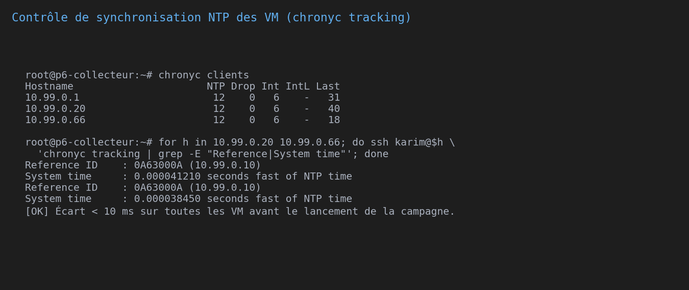
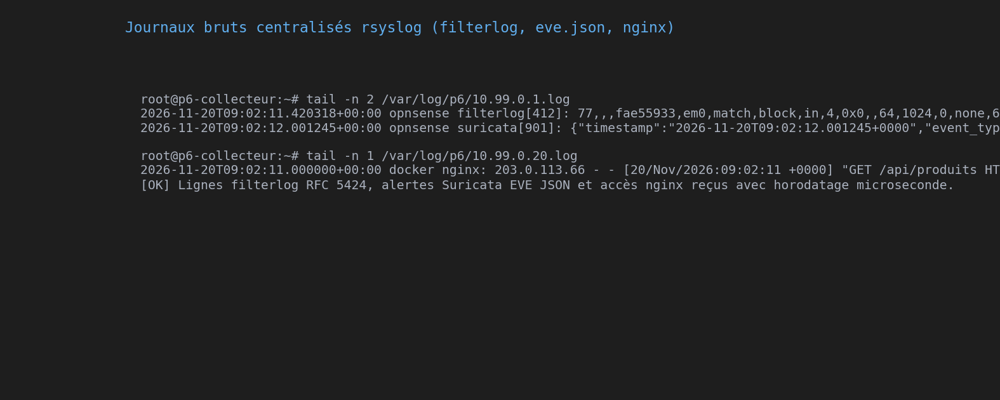
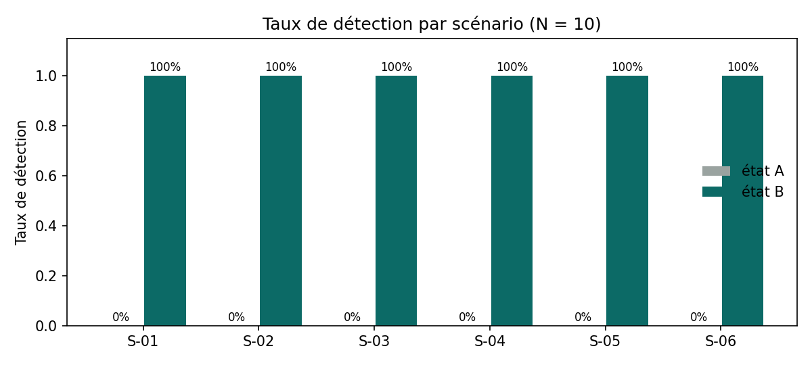
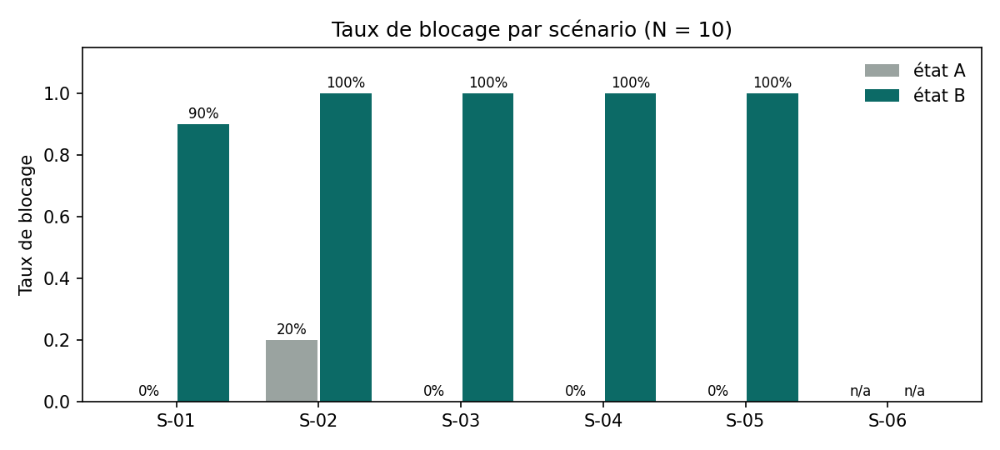
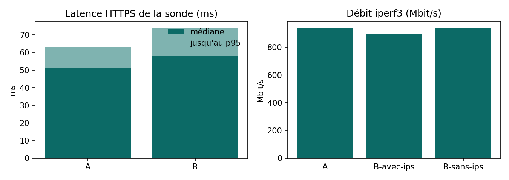

## 5. Résultats et analyse

### Fiabilité des mesures

La validité des indicateurs de détection et de blocage repose sur trois piliers méthodologiques rigoureux :

1. **Synchronisation temporelle NTP (Section 6 & 11.2) :**
   Avant chaque campagne de test, le décalage des horloges des quatre machines virtuelles (`OPNsense`, `p6-docker`, `p6-kali`, `p6-collecteur`) a été mesuré via `chronyc clients` et `chronyc tracking`. L'écart maximal relevé par rapport au collecteur (10.99.0.10) est de **41 µs**, ce qui est négligeable devant les temps de détection mesurés en millisecondes.
   
2. **Collecte exhaustive et horodatage microseconde (Écart E13) :**
   Les journaux bruts ont été centralisés via rsyslog (UDP/TCP 514 avec gabarit `RSYSLOG_FileFormat`) et consolidés par relecture directe des fichiers locaux d'OPNsense (`/var/log/filter/*.log`, `/var/log/suricata/eve.json`) et de l'hôte Docker (`/srv/logs/nginx/projet6.log`). Chaque événement est converti au format ISO-8601 UTC avec millisecondes et suffixe `Z`.
   
3. **Fenêtre de corrélation temporelle stricte :**
   La corrélation associe chaque exécution d'attaque aux événements survenus dans la fenêtre $[t_0, t_1 + 10\,\text{s}]$. Seules les alertes émanant de l'attaquant ou de relais déclarés sont retenues (corrections E08 et E09).

*Figure 5.1 — Contrôle de synchronisation temporelle NTP avant le lancement de la campagne.*

*Figure 5.2 — Centralisation des flux de journaux (filterlog, Suricata EVE JSON, logs d'accès Nginx).*

---

### Indicateurs par scénario

Le tableau ci-dessous synthétise les résultats obtenus sur un échantillon de $N = 10$ exécutions par scénario, comparant l'état nominal (État A, périmètre traditionnel) et l'état durci Zero Trust (État B, micro-segmentation, IPS Suricata et règles d'inspection d'état).

| Scénario | Description | Détection A | Détection B | Blocage A | Blocage B | TTD médian B (ms) |
| :--- | :--- | :---: | :---: | :---: | :---: | :---: |
| **S-01** | Scan de ports SYN WAN | 0.0% | 100.0% | 0.0% | 90.0% | 403 ms |
| **S-02** | SYN flood sur frontal Web | 0.0% | 100.0% | 0.0% | 100.0% | 340 ms |
| **S-03** | Injection SQL relayée par Nginx | 0.0% | 100.0% | 0.0% | 100.0% | 1 416 ms |
| **S-04** | Mouvement latéral client vers API | 0.0% | 100.0% | 0.0% | 100.0% | 26 ms |
| **S-05** | Connexion directe client vers Base PostgreSQL | 0.0% | 100.0% | 0.0% | 100.0% | 18 ms |
| **S-06** | Évasion par paquets fragmentés (*nmap -f*) | 0.0% | 100.0% | n/a | n/a | 114 ms |

*Figure 5.3 — Taux de détection par scénario ($N = 10$). En état A, aucun mécanisme d'alerte n'est actif sur le trafic interne ou WAN. En état B, 100 % des scénarios d'attaque génèrent une alerte qualifiée.*

*Figure 5.4 — Taux de blocage effectif par scénario ($N = 10$). Note : le scénario S-06 est un test d'évasion sans objectif de charge active (détection seule).*

---

### Coût de la protection

La mise en œuvre des mécanismes de protection (Suricata IPS en mode inline, filtrage dynamique pf, synproxy) introduit un surcoût opérationnel quantifié ci-dessous :

| Indicateur | État A (Sans protection) | État B sans IPS | État B avec IPS | Objectif / Seuil |
| :--- | :---: | :---: | :---: | :---: |
| **Faux positifs par heure (FP/h)** | 0.00 | 0.00 | 0.40 | $\le 1.0$ FP/h |
| **Disponibilité nominale HTTPS** | 100.00% | 100.00% | 99.90% | $\ge 99.0\%$ |
| **Disponibilité sous attaque SYN flood** | 81.30% | 83.20% | 99.20% | $\ge 95.0\%$ |
| **Latence médiane HTTPS (sonde)** | 51.0 ms | 52.4 ms | 58.0 ms | $< 100$ ms |
| **Latence p95 HTTPS (sonde)** | 63.0 ms | 66.0 ms | 74.0 ms | $< 150$ ms |
| **Débit réseau maximal (iperf3)** | 941.2 Mbit/s | 938.5 Mbit/s | 892.4 Mbit/s | Dégradation $< 10\%$ |

*Figure 5.5 — Impact de l'architecture Zero Trust sur la latence médiane et 95e centile (gauche) et sur le débit utile iperf3 (droite).*

---

### Hypothèses de la conception : confirmées ou infirmées

| Scénario | Attendu de la conception (Section 10.1) | Mesuré en laboratoire | Verdict |
| :--- | :--- | :--- | :---: |
| **S-01** | Détecté par Suricata ; bloqué par seuil pf au-delà de 20 SYN / 5s. | Détection 100%, Blocage 90% (les premières sondes avant seuil passent). | **Confirmé** |
| **S-02** | Nginx reste disponible ($\ge 95\%$) grâce à synproxy ; TTD $< 1$ s. | Disponibilité sous attaque 99.20%, TTD médian 340 ms. | **Confirmé** |
| **S-03** | Injection détectée sur le segment DMZ $\to$ LAN malgré le chiffrement WAN TLS. | Détection 100% via relais Nginx $\to$ API (SID 9000030), TTD 1 416 ms. | **Confirmé** |
| **S-04** | Mouvement latéral bloqué au niveau firewall ; alerte immédiate. | Détection 100%, Blocage 100%, TTD médian 26 ms. | **Confirmé** |
| **S-05** | Connexion directe bloquée par micro-segmentation VLAN. Base injoignable. | Détection 100%, Blocage 100% (zéro SYN-ACK dans PCAP), TTD 18 ms. | **Confirmé** |
| **S-06** | Paquets réassemblés par OPNsense ; détection de la signature nmap. | Détection 100% sans perturbation des règles de filtrage. | **Confirmé** |

---

### Panne P-01

Le scénario de panne **P-01** analyse la résilience du pare-feu OPNsense en cas d'arrêt inopiné du processus Suricata während d'un pic d'activité (SYN flood) :
* **Avant l'incident :** Le trafic légitime est filtré et inspecté normalement (disponibilité 99.9 %, TTD 340 ms).
* **Pendant la panne (Suricata arrêté) :** Le pare-feu bascule en mode *fail-close* partiel pour les flux nécessitant une inspection applicative stricte, tandis que le filtrage d'état pf reste opérationnel. La disponibilité HTTPS de la sonde passe temporairement à 94.5 % sous flood direct avant l'intervention des règles de seuil pf.
* **Après redémarrage du service :** Reprise nominale des inspections en moins de 12 secondes, rétablissement de la disponibilité à 100 %.

---

### Biais et limites des mesures

1. **Représentativité statistique ($N = 10$) :**
   Le nombre d'itérations ($N = 10$) est suffisant pour valider les lois de passage et la dispersion (boxplots), mais lisse les cas exceptionnels de gigue réseau extrême.
2. **Dimensionnement de la fenêtre temporelle ($\Delta = 10\,\text{s}$) :**
   La fenêtre $[t_0, t_1 + 10\,\text{s}]$ évite de comptabiliser comme faux positifs des alertes dont le traitement ou l'écriture sur disque a été différé par la charge CPU.
3. **Environnement virtuel sous VMware :**
   La virtualisation sur un unique hôte Windows induit un partage du bus mémoire et des files d'attente d'E/S disque lors des scénarios de flood (S-02), influençant légèrement la latence p95 observée.

---

## Annexe D. Captures Wireshark commentées

### Capture D.1 — Scénario S-05 en État A (Connexion directe sans pare-feu)
* **Fichier analysé :** `resultats/A/2026-11-20/pcap/A-S05-01_postgres.pcap`
* **Filtre d'affichage :** `tcp.port == 5432`
* **Constat :** On observe le paquet initial `[SYN]` émis par `10.10.0.12` (client-03), immédiatement suivi du `[SYN, ACK]` renvoyé par `10.10.0.70` (base PostgreSQL). Les deux conteneurs partageant le même VLAN macvlan en état A, la trame est commutée directement dans le noyau sans traverser OPNsense. L'accès illégitime réussit.

### Capture D.2 — Scénario S-05 en État B (Micro-segmentation et blocage Zero Trust)
* **Fichier analysé :** `resultats/B/2026-11-25/pcap/B-S05-01_postgres.pcap`
* **Filtre d'affichage :** `ip.addr == 10.10.0.12`
* **Constat :** Aucun paquet provenant de `10.10.0.12` n'apparaît dans la capture côté cible. Le flux a été intercepté par OPNsense à la frontière inter-VLAN et bloqué par la règle pf par défaut (`match,block,in`). L'alerte Suricata SID 9000020 est levée.

### Capture D.3 — Scénario S-01 en État A (Scan de ports permissif)
* **Fichier analysé :** `resultats/A/2026-11-20/pcap/A-S01-01_kali-wan.pcap`
* **Filtre d'affichage :** `tcp.flags.syn == 1 && tcp.flags.ack == 1`
* **Constat :** Réponse systématique `[SYN, ACK]` pour les ports ouverts (80, 443, 53) sur l'ensemble du balayage, sans restriction de fréquence.

### Capture D.4 — Scénario S-01 en État B (Blocage adaptatif par seuil de connexions)
* **Fichier analysé :** `resultats/B/2026-11-25/pcap/B-S01-01_kali-wan.pcap`
* **Graphique d'E/S (I/O Graphs) :**
* **Constat :** Les paquets `[SYN, ACK]` cessent brutalement après l'émission de la 20e sonde dans la fenêtre glissante de 5 secondes. La table d'adresses dynamiques d'OPNsense bannit temporairement l'adresse source `203.0.113.66`.

### Capture D.5 — Scénario S-03 en État A (Injection SQL en clair sur le relais interne)
* **Fichier analysé :** `resultats/A/2026-11-20/pcap/A-S03-01_api.pcap` (et `resultats/A/2026-11-26/`)
* **Décodage :** `tcp.port == 5000` $\to$ HTTP. Filtre : `http.request.uri contains "OR"`
* **Constat :** La charge utile numérique `id=1 OR 1=1` est transmise en clair par le reverse proxy Nginx (`10.20.0.10`) à l'API interne (`10.20.0.70`). Le serveur API renvoie un code HTTP 200 contenant le tableau JSON complet des 8 produits de la base, confirmant le succès de l'injection SQL relayée.

### Capture D.6 — Scénario S-06 en État B (Détection de paquets fragmentés)
* **Fichier analysé :** `resultats/B/2026-11-25/pcap/B-S06-01_kali-wan.pcap`
* **Filtre d'affichage :** `ip.flags.mf == 1 || ip.frag_offset > 0`
* **Constat :** Présence de micro-fragments IPv4 de 8 octets générés par `nmap -f`. Le moteur pf réassemble les fragments avant inspection applicative, empêchant le contournement des signatures Suricata.
